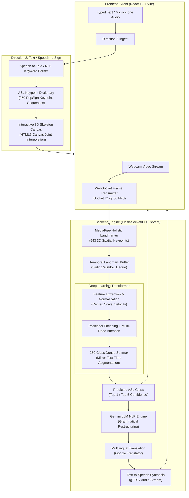

# SignBridge 🤟

> **Bidirectional AI-Powered American Sign Language (ASL) Translation & Accessibility Platform**  
> An end-to-end deep learning system bridging communication between the Deaf and Hard-of-Hearing (DHH) community and non-signers. Features real-time 3D skeletal tracking, custom Transformer architecture trained on 250 ASL signs, Gemini LLM grammatical restructuring, and bidirectional Sign-to-Text & Text-to-Sign translation.

[](https://www.python.org/)
[](https://pytorch.org/)
[](https://developers.google.com/mediapipe)
[](https://reactjs.org/)
[](https://flask-socketio.readthedocs.io/)
[](https://ai.google.dev/)
[](#-model-benchmarks--evaluation-results)

---

## 📌 Contents

1. [Key Features](#-key-features)
2. [System Architecture](#-system-architecture)
3. [Model Benchmarks & Evaluation Results](#-model-benchmarks--evaluation-results)
4. [Bidirectional Workflows](#-bidirectional-workflows)
5. [Repository Layout](#-repository-layout)
6. [Prerequisites & Setup](#-prerequisites--setup)
7. [Running the Application](#-running-the-application)
8. [Dataset & Training Methodology](#-dataset--training-methodology)
9. [Accessibility & Comfort Settings](#-accessibility--comfort-settings)
10. [Citations & Acknowledgments](#-citations--acknowledgments)

---

## 🌟 Key Features

* **Real-Time 3D Landmark Tracking**: MediaPipe Holistic landmarker tracks 543 spatial keypoints (hands, pose, facial contours) at 30+ FPS directly from standard webcam feeds.
* **Deep Transformer Classifier**: Multi-head self-attention architecture trained on the 250-class Google PopSign ASL dataset, achieving **80.24% Top-1** and **92.46% Top-5 accuracy**.
* **LLM-Powered Sentence Reconstruction**: Raw predicted gloss sequences (e.g., `["WANT", "WATER"]`) are naturally reconstructed into fluent grammatical English (e.g., *"I would like some water, please."*) via Google Gemini 2.0 Flash with a two-pass grammar refinement engine.
* **Bidirectional Communication**:
  * **Direction 1 (Sign → Text & Speech)**: Real-time sign detection from webcam → sentence synthesis → multilingual text translation → Text-to-Speech (gTTS / Web Speech API).
  * **Direction 2 (Speech/Text → Sign)**: Speech-to-text or typed input in any language → keyword extraction → animated 3D skeletal avatar canvas rendering.
* **High-Throughput Inference Engine**: Optimized PyTorch pipeline processing **482.7 samples/second** with Mirror Test-Time Augmentation (TTA).
* **Inclusive Accessibility Suite**: Integrated contrast modes, adjustable font scaling, dark/light themes, and hands-free voice controls designed for users of all abilities.

---

## 📐 System Architecture



---

## 📊 Model Benchmarks & Evaluation Results

Evaluated on **9,429 held-out test samples** across 250 vocabulary classes:

| Metric | Model v1 (Baseline) | Model v2 (Enhanced + Mirror TTA) |
|---|---|---|
| **Top-1 Accuracy** | 71.38% | **80.24%** |
| **Top-5 Accuracy** | 89.61% | **92.46%** |
| **Macro Precision** | 71.57% | **80.50%** |
| **Macro Recall** | 71.18% | **80.13%** |
| **Macro F1-Score** | 70.88% | **80.04%** |
| **Weighted F1-Score** | 71.08% | **80.17%** |
| **Inference Speed** | 334.2 samples/sec | **482.7 samples/sec** (19.53s total) |

### Key Research Figures

The evaluation suite generates 14 publication-grade analytical charts in `asl-signs/paper_figures_v2/`:
* `fig1_confusion_matrix.png`: 250×250 normalized confusion matrix demonstrating low off-diagonal confusion.
* `fig10_precision_recall_scatter.png`: Scatter plot across all 250 signs validating balanced precision and recall.
* `fig11_f1_distribution.png`: Histogram and KDE density curve of per-class F1 distribution peaking at >80%.
* `fig12_prf1_grouped_bars.png`: Detailed precision, recall, and F1 comparisons for top and bottom performing signs.
* `fig14_f1_heatmap_grid.png`: 16×16 semantic vocabulary heatmap illustrating complete class performance.

---

## 🔄 Bidirectional Workflows

### 1. Direction 1: Sign → Text & Speech
1. User activates webcam in the **Sign to Text** dashboard.
2. MediaPipe extracts facial contours, pose landmarks, and hand finger joints in real-time.
3. Frames are continuously classified into candidate ASL glosses (e.g. `["FEEL", "TIRED", "TODAY"]`).
4. When the user finishes signing, **Google Gemini 2.0 Flash** restructures the glosses into a grammatically coherent sentence:
   > *"I am feeling quite tired today."*
5. The sentence can be translated into multiple languages and played aloud via Text-to-Speech.

### 2. Direction 2: Speech / Text → Sign
1. A hearing user speaks into the microphone (or types into the prompt box).
2. The speech is transcribed and parsed to extract key semantic ASL concepts.
3. The system maps keywords against the PopSign 250-sign vocabulary.
4. The animated **SkeletonCanvas** dynamically interpolates the corresponding 3D anatomical coordinates, rendering the sign gesture sequentially on screen.

---

## 📁 Repository Layout

```
signbridge/
├── asl-signs/                         # Model training, features & evaluation pipeline
│   ├── eval_outputs_v2/               # Benchmark metrics, per-class accuracies & JSON summaries
│   ├── model_v2/                      # Trained PyTorch Transformer checkpoint (best_model.pt)
│   ├── paper_figures_v2/              # 14 publication-quality evaluation figures (300 DPI)
│   ├── evaluate_v2.py                 # Evaluation benchmark script with Test-Time Augmentation
│   ├── phase2b_features.py            # 3D spatial feature extraction & normalization
│   ├── phase3b_train.py               # PyTorch Transformer model training loop
│   ├── sign_to_prediction_index_map.json # 250 vocabulary class mappings
│   └── holistic_landmarker.task       # MediaPipe Holistic Vision task model
├── sub/                               # Full-stack production application
│   ├── backend/                       # Python Flask-SocketIO backend
│   │   ├── app.py                     # WebSocket frame processing & REST API server
│   │   ├── signbridge_nlp.py          # Gemini LLM sentence reconstruction & translation
│   │   ├── requirements.txt           # Python backend dependencies
│   │   └── .env.example               # Environment variables template
│   ├── frontend/                      # React 18 + Vite frontend
│   │   ├── src/                       # React components (Direction1, Direction2, SkeletonCanvas)
│   │   ├── package.json               # Node.js dependencies (Framer Motion, Socket.IO client)
│   │   └── vite.config.js             # Vite configuration
│   ├── New folder (2)/                # Production inference runtime
│   │   ├── asl_infer_v2.py            # Real-time PyTorch inference engine
│   │   ├── best_model.pt              # Production weights (14 MB)
│   │   └── holistic_landmarker.task   # MediaPipe task runtime (13 MB)
│   └── run-dev.ps1                    # One-click Windows startup script
├── .gitignore                         # Comprehensive gitignore (excludes heavy datasets & venvs)
└── README.md                          # Project documentation
```

---

## ⚡ Prerequisites & Setup

### Requirements

* **Python 3.10+**
* **Node.js 18+** & **npm**
* A webcam and microphone for live interaction.
* A free **Google Gemini API Key** (from [Google AI Studio](https://aistudio.google.com/app/apikey)).

### 1. Clone Repository

```bash
git clone https://github.com/Tabsirshaikh/signbridge.git
cd signbridge
```

### 2. Backend Setup

```bash
cd sub/backend

# Create and activate virtual environment
python -m venv .venv

# Windows (PowerShell):
.venv\Scripts\Activate.ps1
# Linux / macOS:
source .venv/bin/activate

# Install backend dependencies
pip install -r requirements.txt
```

### 3. Configure Gemini API Key

Copy the sample environment file in `sub/backend`:

```powershell
cp .env.example .env
```

Open `sub/backend/.env` and insert your Gemini API Key:

```env
GEMINI_API_KEY=your_actual_gemini_api_key_here
```

### 4. Frontend Setup

```bash
cd ../frontend
npm install
```

---

## 🚀 Running the Application

### Option A: One-Click Startup (Windows PowerShell)

From the project root:

```powershell
.\sub\run-dev.ps1
```

* Opens the Flask backend server in a dedicated process on `http://localhost:5000`.
* Launches the Vite React frontend on `http://localhost:3000`.

### Option B: Manual Two-Terminal Startup

**Terminal 1 — Backend:**
```powershell
cd sub/backend
python app.py
```

**Terminal 2 — Frontend:**
```powershell
cd sub/frontend
npm run dev
```

Open your browser at **`http://localhost:3000`** to start using SignBridge!

---

## 🔬 Dataset & Training Methodology

SignBridge is trained on the **Google PopSign ASL Dataset**, comprising isolated video demonstrations of 250 common signs.

1. **Feature Extraction**:
   - For each frame, MediaPipe Holistic extracts 3D coordinates for the face, body pose, and bilateral hands.
   - Landmarks are centered on the mid-shoulder anchor and normalized by inter-shoulder distance.
   - Missing hand keypoints are filled with spatial confidence zeroing and temporal smoothing.
2. **Transformer Architecture**:
   - Positional Encoding injected over sequence lengths up to 30 frames.
   - Multi-Head Self-Attention layers capturing fine-grained fingerspelling motion and holistic trajectory.
   - Dropout and Layer Normalization for cross-subject generalization.
3. **Inference Optimization**:
   - Mirror Test-Time Augmentation (TTA) flips left/right hands to guarantee ambidextrous signer invariance, boosting Top-1 accuracy to **80.24%**.

---

## ♿ Accessibility & Comfort Settings

The UI includes a dedicated **Comfort Panel** accessible anytime:
* **High Contrast Mode**: Tailored for low-vision signers with high-visibility borders and dark backgrounds.
* **Text Scaling**: Adjustable font sizes from 100% to 150%.
* **Visual Clutter Toggle**: Ability to hide non-essential background animations and focus entirely on the skeleton canvas.
* **Hands-Free Speech Controls**: Native speech-to-text integration enabling verbal users to communicate without typing.

---

## 📜 Citations & Acknowledgments

* **Google PopSign Project**: For providing the public American Sign Language landmark dataset.
* **Google MediaPipe**: For lightweight, real-time on-device 3D landmark detection.
* **Google Gemini AI**: For LLM-based grammar and semantic context completion.
